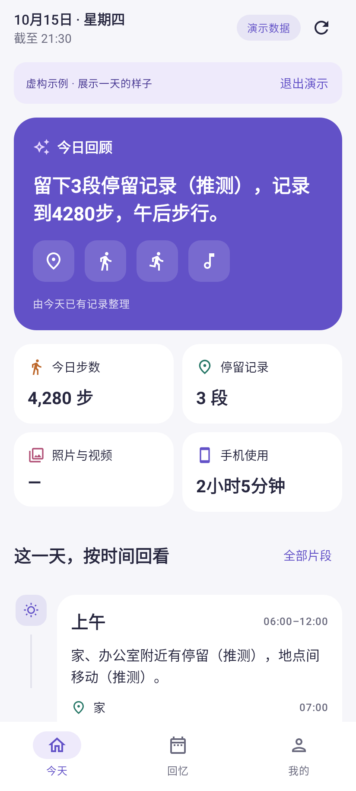
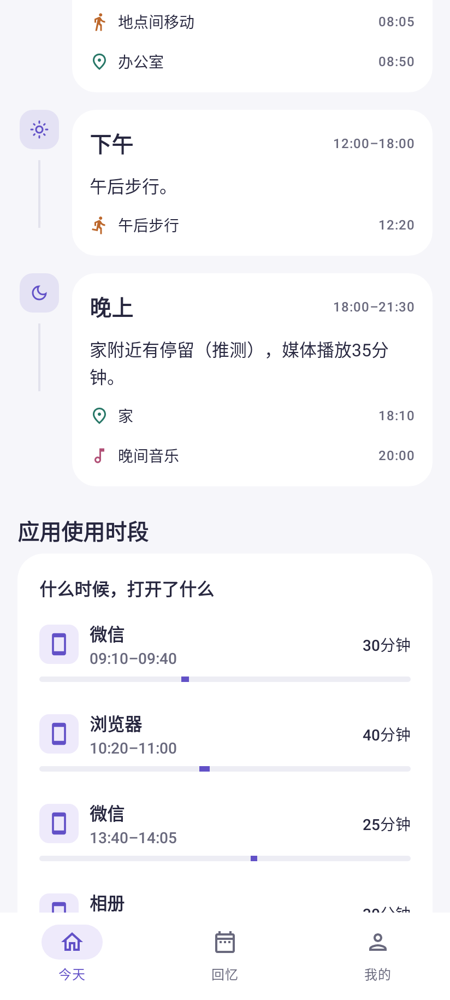

# 1.2.0 · 一天总结、直接授权与手机计步

对应应用1.2.0（5），更新日期2026-10-15。按本次反馈调整现有原生Android应用，保留个人签名、加密数据库和原始记录。

## 打开即申请系统权限

首次进入本版，在本地数据就绪且界面解锁后，直接合并申请身体活动、定位、照片视频、日历以及适用系统的通知权限。删除旧欢迎页、来源勾选引导和“继续，到系统确认”说明弹层；系统自身按权限组展示的确认不能合并成应用代替点击。

随后按需进入系统的使用情况访问、通知使用权页面，返回后继续下一项。同一轮只出现一次，已授权的跳过，拒绝不循环。普通权限曾被系统设为不再询问时，不在启动时重复申请，单项“管理授权”直达应用设置。特殊访问队列跟随Activity保存/恢复。

初次使用在系统流程结束后自动开始记录。用户原有的暂停、停止、关闭来源和排除设置保留。“我的 → 记录权限”可以统一申请缺少权限，也可单独点击直达系统。后台定位、健康后台读取与无障碍保留独立入口。

## 手机计步兼容修复

旧实现只读取默认累计计步传感器，没有检查注册返回值，采用五分钟批量回调与较长写入等待，容易出现已授权但一直没有步数或无法发现兼容硬件的情况。这些是已从代码确认的问题；尚未取得目标华为手机的传感器运行日志，不能据此断言设备上唯一原因。

本版的处理：

1. 先允许申请身体活动权限，再判断传感器能力，避免厂商在授权前隐藏硬件造成永久不可用。
2. 检查累计计步、唤醒/非默认传感器和硬件单步检测器。注册返回false时重试即时回调，再尝试其他传感器。
3. 累计计步器注册后45秒仍无首样本、且存在单步检测器时，注销原流并切换；任何时候只累计一个数据流。
4. 首个累计样本只建基线，不把开机累计值当作今天步数。使用传感器时间还原批量事件的真实时刻，过滤重复、非有限值、非法单步值和未来事件。
5. 缩短批处理等待；连接中、等待走动、正常和连接失败分别展示。首页与权限页可重连。

手机计步独立于Health Connect，不要求华为手机安装Google健康服务；也没有接入华为运动健康账户的历史数据。暂停、服务重启或重新连接会建立新基线，无法可靠补回的步数不猜测。没有向第三方开放计步硬件的设备会显示不可用，不启用全天高频加速度计来掩盖缺口。

## 首页内容

| 顺序 | 展示内容 | 数据口径 |
|---|---|---|
| 今日回顾 | 一段可读的一天总结，配合地点、步行、音乐等图标 | 从已有片段生成；推测保持标识，计划/未知/未来事件不作为已发生经历 |
| 一天统计 | 步数、停留段数、照片视频、手机使用 | 缺失显示“—”；手机活动按区间并集，不重复累计分屏 |
| 图文时间线 | 凌晨、上午、下午、晚上，每段有总结、图标、事件时间和真实相册缩略图 | 图片按记录时间归属；跨时段步数只进入区间结束所在时段；照片不可访问明确提示 |
| 应用使用时段 | 应用真实图标、开始时间—结束时间、时长和一天中的区间色条 | 保留每一段的间隔；只显示已观察区间；首页最多8段，完整列表按需打开 |

图片点击进入来源片段；应用图标通过系统PackageManager在IO线程加载并使用有界缓存。照片采用系统缩略图接口，不复制图库。演示内容独立、明确标注；没有使用虚构照片伪装用户的一天。

## 验证与预览

生产Compose组件通过Robolectric API35原生图形路径渲染，并检查正常尺寸、360dp小屏/1.5倍字体、深色、授权直达回调、照片不可访问、计步重连和时间线跳转。它们不等于华为实机截图或系统权限弹窗验证。

最新测试数量、构建结果和APK哈希见[实际验证报告](Verification.md)。目标设备HUAWEI HBN-AL80、HarmonyOS4.2（报告的Android12/API31）的实际计步、后台冻结、锁屏恢复和耗电仍待真机确认。

[首页](ui/v1.2.0/03-today.png) · [时段与时间线](ui/v1.2.0/04-visuals.png) · [授权管理](ui/v1.2.0/01-permissions.png) · [照片不可访问状态](ui/v1.2.0/02-photo-timeline.png) · [计步重连](ui/v1.2.0/11-step-retry.png)

## 接口依据

- [Android motion sensors](https://developer.android.com/develop/sensors-and-location/sensors/sensors_motion)：累计计步与单步检测需要身体活动权限，首个累计值属于启动周期而不是当天。
- [Android SensorManager](https://developer.android.com/reference/android/hardware/SensorManager)：检查registerListener返回值，区分批量延迟和即时交付。
- [Android运行时权限](https://developer.android.com/training/permissions/requesting)：由系统处理授权结果，保留拒绝后的可用路径。
- [Huawei Health Service Kit接入FAQ](https://developer.huawei.com/consumer/es/doc/HMSCore-Guides/faq-0000001477339981)：华为健康数据需要独立服务接入与用户授权，本版不将Android手机计步与华为健康历史同步混为一谈。
