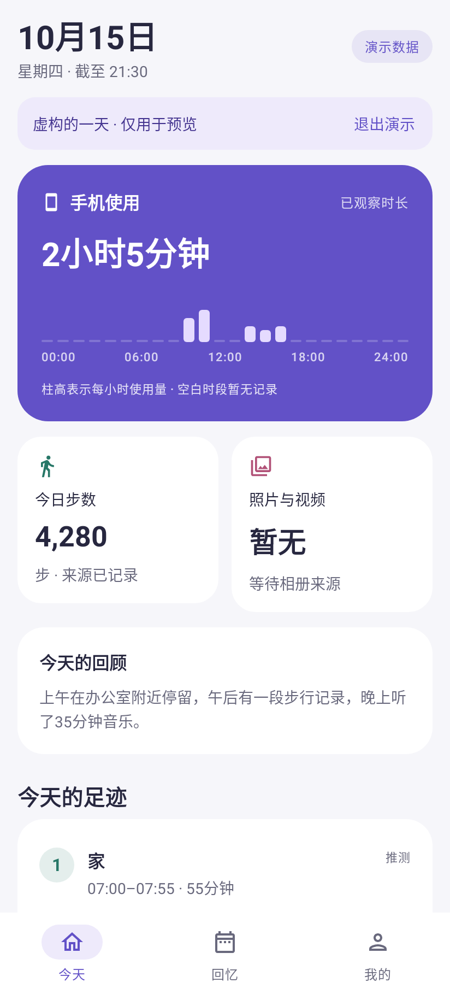
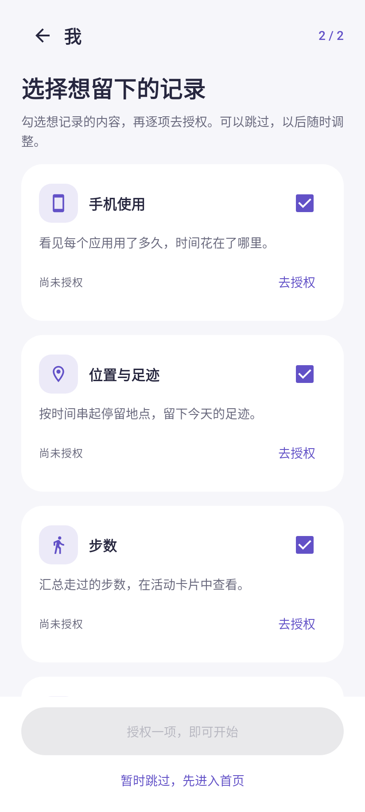

# 1.1.0 界面与授权流程重构

更新：2026-10-15。对象：原生 Android 应用“我”，兼容 Android 10+，包含离线与增强两个构建。

## 目标

打开应用后能知道如何开始，授权时知道为什么需要权限；有记录时能直接看见一天的活动、停留和时间分配。主界面避免让使用者先理解技术来源、四条轨道或后台采集参数。

本次检查以当前源码和新页面的原生 Compose 渲染为依据。没有访问用户的手机，也没有把旧版本代码分析冒充旧版实机截图审计。

## 信息架构

底部固定三个入口：

| 入口 | 首要问题 | 展示和操作 |
|---|---|---|
| 今天 | 今天留下了什么？ | 手机使用量和小时柱图、步数、照片/视频、事实回顾、停留顺序、应用时长排行、最近生活片段 |
| 回忆 | 以前那天发生了什么？ | 月历、历史日摘要、日期详情与片段筛选 |
| 我的 | 怎样管理记录？ | 状态、暂停/继续、记录权限、生活趋势、数据与隐私、独立演示 |

搜索始终可从主页面顶部进入。高级配置保留在“数据与隐私”，避免把初次使用变成长设置表。

## 首次使用与权限

1. 欢迎页用明确标注的虚构片段说明结果，提供“设置记录权限”“先看看示例”和“跳过”。
2. 选择页先展示手机使用、位置、步数、照片与视频，其他来源可展开。
3. 每张卡片分别表达“是否选择记录”和“系统是否已授权”，两者不会混为一谈。
4. 点击“去授权”打开用途说明；只有“继续，到系统确认”触发权限请求或系统设置。
5. 返回应用后重新探测状态并重建已开启的传感器监听，支持拒绝、部分授权、设备不可用；不能重复弹出系统请求时转到应用设置。
6. 至少一项所选来源可用后，“开始记录”保存所选来源并启动已有采集流程。跳过不会自行开启新记录，也不会停止旧用户已有记录。
7. “我的 → 记录权限”可调整，底部固定开始/继续/同步按钮。后台定位、健康后台读取与状态通知是独立的手动操作。

仅打开说明面板不会请求系统权限。被拒绝的来源不阻塞浏览，其他获授权来源可继续。通知与音乐共用系统通知使用权，但参与记录的开关分别保留。

## 图表与事实

| 视觉内容 | 数据口径 | 缺失处理 |
|---|---|---|
| 小时柱图 | 已观察应用活动区间，裁剪到当天和观察截止时间；同小时重叠取并集 | 不补造未观察时段 |
| 应用时长排行 | 同一应用的区间并集，按时长降序，显示前五个 | 没有数据不显示虚构排行 |
| 步数、相册 | 已有来源指标 | “暂无”，不写成0 |
| 停留顺序 | 来源支持的停留片段，按时间排序 | 推测标记保留；点击查看依据和命名 |
| 生活时间线 | 上午/下午/晚上分组，足迹/活动/应用/生活筛选 | 无片段给出下一步说明 |
| 七日趋势 | 每日已有应用活动指标 | “—”表示缺失，已知0仍为0 |

分屏应用可能重叠，不能把各应用时长简单相加当作总量。计划、未知和时钟冲突片段不作为已观察使用时间。日期长度来自时区窗口，覆盖夏令时的23/25小时日期。

演示样本只存在内存中，页面带“演示数据”和退出按钮。从演示进入权限页面会回到真实状态。不会把样本写入正式数据库。

## 视觉系统

- 浅灰背景、白色卡片、紫色主操作；深色模式单独配色。
- 标题、正文、辅助信息有统一层级。卡片通常20–28dp圆角，内容间距按8dp节奏组织。
- 使用Material官方图标，避免用字符符号代替导航。
- 主要操作至少52dp高；来源复选框有可读名称。授权底部操作固定，内容可滚动。
- 原生列表按需组合，没有新增持续动画、轮询或采集频率。
- 图表同时提供数字、文字解释和无障碍语义，不仅依赖颜色区分。

## 渲染与验收

UiFlowTest使用实际生产Compose组件和Robolectric原生图形模式；授权系统返回由受控状态模拟。截图由Android View/Skia直接渲染，未重画成网页或效果图。

覆盖欢迎页、选择页、授权确认与跳过、首页与滚动图表、空状态、深色模式、360dp宽度与1.5倍字体、时间线筛选、日历选择和我的入口。截图与测试结果由本次构建生成，最终状态见[验证报告](Verification.md)。

这些检查不能代替华为系统权限页、后台存活和真实来源准确性的真机验收。覆盖安装后应完成一次“授权 → 返回 → 开始记录 → 查看来源数据”的实际操作。

## 设计依据

已阅读Product Design的设计目标、交互审查和视觉检查技能；结合本项目现有Android代码进行重构，没有新建网页替代原生应用。

- [Android运行时授权原则](https://developer.android.com/training/permissions/requesting)：在用户触发相关功能时请求、说明用途、允许拒绝和继续。
- [Android首次使用引导](https://developer.android.com/design/ui/mobile/guides/patterns/onboarding)：用简洁引导说明价值，提供可理解的权限准备说明。
- [Material 3基础规范](https://m3.material.io/foundations/)：统一组件、字体、颜色、布局和交互状态。

## 原生界面预览

以下为原生组件渲染，使用明确标注的演示数据。

[首次欢迎](ui/v1.1.0/01-welcome.png) · [逐项授权](ui/v1.1.0/02-permissions.png) · [首页](ui/v1.1.0/03-today.png) · [足迹、时长和时间线](ui/v1.1.0/04-visuals.png) · [回忆](ui/v1.1.0/09-history.png) · [我的](ui/v1.1.0/10-me.png)

